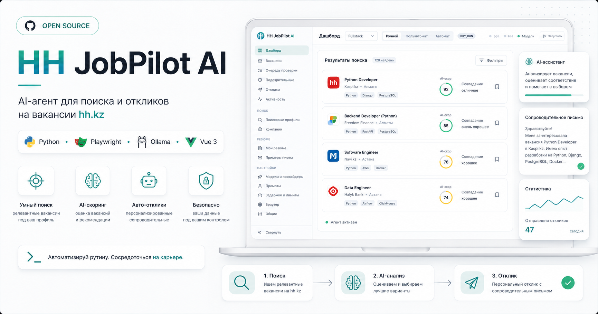
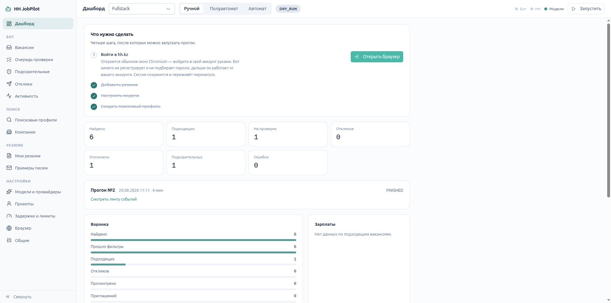

<p align="center">
  
</p>

# HH JobPilot AI

Локальное приложение для поиска вакансий на hh.kz, оценки их пригодности,
написания сопроводительных писем и отправки откликов.

Работает целиком на своей машине: база — SQLite, модель — Ollama, браузер —
видимый Chromium. Наружу уходят только запросы к hh.kz и, если вы сами
настроите внешнего провайдера, к его API.

Правила разработки — в [CLAUDE.md](CLAUDE.md).

## Как выглядит



Дашборд ведёт по четырём шагам настройки, показывает счётчики последнего
прогона и воронку: сколько вакансий нашлось, сколько прошло фильтры, сколько
дошло до отклика. Сверху — переключатель режима автономности
(ручной / полуавтомат / автомат) и отдельно `DRY_RUN` или `LIVE`.

## Что нужно на машине

```
Python 3.12+     Node 20+     Ollama с моделью qwen3:4b-instruct
```

## Запуск

```bash
make setup    # окружение, зависимости, Chromium для Playwright, миграции
make dev      # backend :8000, frontend :5173, Ollama — одной командой
```

`make check` показывает, чего не хватает. Полный список команд — `make help`.

После `make dev`:

```
интерфейс     http://localhost:5173
документация  http://localhost:8000/docs
```

## Разработка

```bash
make test     # pytest + vitest
make fmt      # ruff format + prettier
make lint     # ruff + mypy + eslint + vue-tsc
make revision M="что изменилось"   # новая миграция Alembic
make migrate                        # применить миграции
```

Тесты не требуют ни браузера, ни Ollama, ни интернета — провайдер модели и
Playwright мокаются, база поднимается в памяти.

## Как устроено

```
backend/app/
  api/        HTTP, без бизнес-логики
  pipeline/   оркестрация прогона
  browser/    Playwright; все селекторы HH — в selectors.py
  filters/    отсев без модели, чистые функции
  llm/        провайдеры, промпты, схемы ответов
  storage/    модели и доступ к данным
  core/       конфиг, коды статусов и ошибок
frontend/src/
  pages/ layouts/ components/   экраны
  api/ schemas/ queries/        доступ к бэкенду, Zod-схемы, TanStack Query
  stores/                       Pinia: только состояние интерфейса
```

Фронтенд ходит только в собственный API — ни в SQLite, ни в Ollama, ни на hh.kz.

## Порядок настройки

1. **Резюме** — вставьте текст с hh.kz, заполните Allowed Facts.
2. **Модели и провайдеры** — локальная Ollama заводится сама при первом старте.
   Задайте маршруты: анализ дешевле гонять локально, письма — на модели получше.
3. **Резюме → Собрать выжимку** — один вызов модели, дальше она идёт в каждый промпт
   вместо полного текста.
4. **Браузер** — запустите и войдите в HH вручную. Сессия переживает перезапуск.
5. **Поисковые профили** — запросы, регионы, зарплата, стоп-слова, лимит за прогон.
6. **Задержки и лимиты** — при желании поправьте паузы и дневной лимит откликов.
7. Запустите прогон. Первый прогон нового резюме принудительно идёт в `DRY_RUN`.

Режим `LIVE` включается только руками, в шапке. Это защита от ситуации
«настроил не то и разослал двадцать откликов».

## Чего приложение не делает

Не обходит капчу и антибот-защиту HH, не подменяет fingerprint, не
автоматизирует веб-интерфейсы chatgpt.com и claude.ai, не заполняет поля с
личными данными и не отправляет два отклика на одну вакансию.
