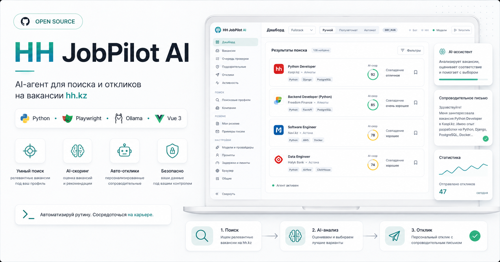
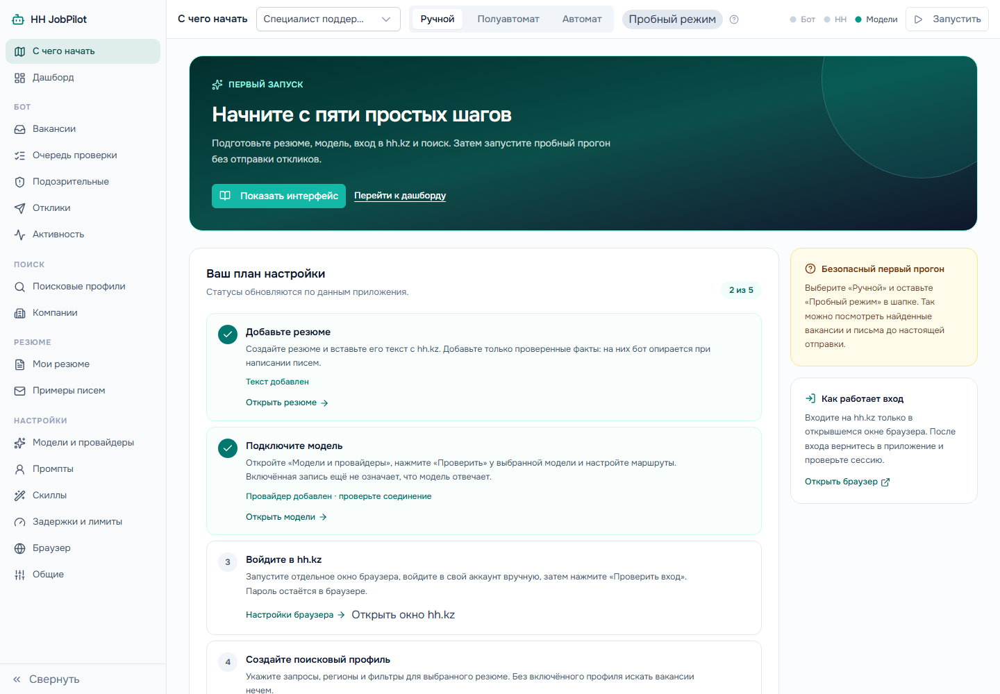
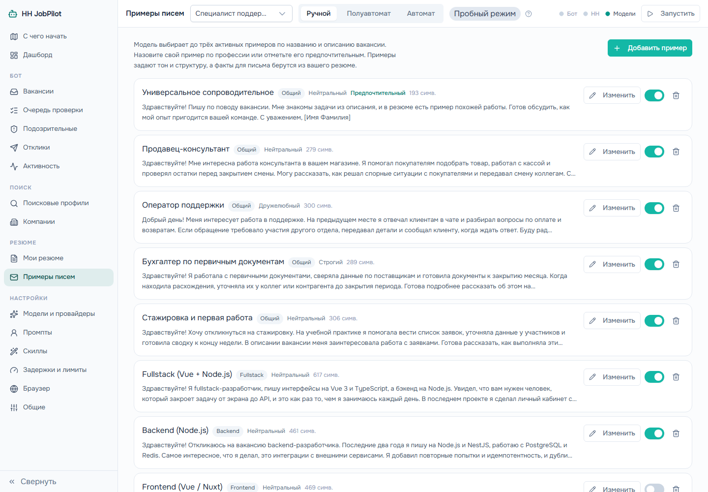
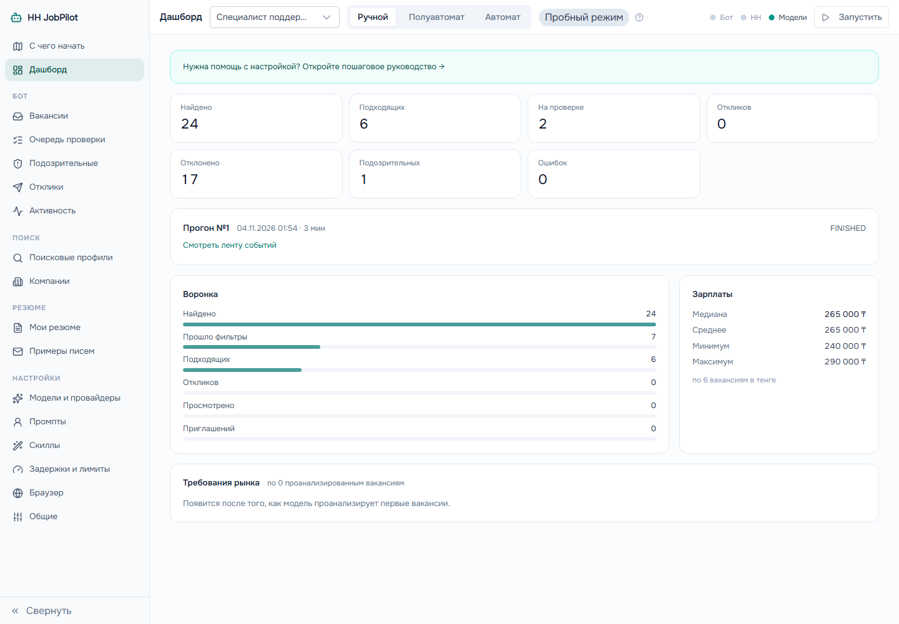

<p align="center">
  
</p>

# HH JobPilot AI

HH JobPilot AI помогает искать вакансии на hh.kz по вашему резюме и готовить
сопроводительные письма. Подходит для разных профессий и для первой работы.
Укажите, что ищете, проверьте найденные вакансии и решите, куда откликнуться.

Приложение рассчитано на одного пользователя и запускается на его компьютере. Для работы достаточно своего
аккаунта hh.kz и локальной модели [Ollama](https://ollama.com/library/qwen3:4b-instruct).
При подключении внешней модели текст для анализа и письма передаётся её провайдеру.

## Первый запуск

1. Скачайте проект через **Code → Download ZIP** или клонируйте репозиторий.
2. Запустите приложение одним из способов ниже и откройте **С чего начать**.
3. Войдите в свой аккаунт hh.kz в окне браузера. В **Мои резюме** добавьте
   текст и ссылку на своё резюме, затем нажмите **Собрать выжимку**.
4. В **Поисковых профилях** укажите названия должностей, регион, формат работы,
   требования к стажу и минимальную зарплату. Для разных целей можно создать
   отдельные резюме и профили.
5. Запустите поиск в `DRY_RUN` и проверьте вакансии и черновики. В этом режиме
   отклики не отправляются.



## Поиск и письма

| Что ищете | Примеры запросов | Что добавить в резюме |
| --- | --- | --- |
| Поддержка | оператор чата, специалист поддержки | Каналы связи, типы обращений, примеры решённых вопросов |
| Продажи | продавец-консультант, менеджер по продажам | Работа с клиентами, кассой или CRM, подтверждённые результаты |
| Бухгалтерия | бухгалтер, бухгалтер по первичным документам | Участки учёта, документы и программы, с которыми работали |
| Первая работа | стажёр, помощник бухгалтера | Учебная практика, проекты, задачи, которые выполняли сами |

В разделе **Примеры писем** есть универсальный образец и примеры для продаж,
поддержки, бухгалтерии, стажировок и IT. Назовите свой пример по целевой роли,
чтобы он подбирался по названию и описанию вакансии. Отметка
«Предпочтительный» позволяет использовать пример даже без совпадения слов.
Из образцов модель берёт тон и структуру. Факты для письма берутся из вашего
резюме и дополнительных сведений.

В карточке вакансии откройте блок письма. Можно сгенерировать черновик заново,
изменить текст вручную, сохранить свою версию и запустить проверку фактов.



Дашборд показывает результаты поиска и количество вакансий на проверке.
Режим отправки `LIVE` включается отдельно. В полуавтоматическом режиме
можно подтверждать отклики из очереди проверки.



## Запуск

Два способа, выберите один: **Docker** (проще, ничего кроме Docker и Ollama ставить не нужно)
или **из терминала** (удобнее для разработки). Одновременно их не запускайте — у них общие
порты.

### Docker

Нужны [Docker Desktop](https://www.docker.com/products/docker-desktop/) и Ollama на самой
машине (`ollama pull qwen3:4b-instruct`).

```bash
docker compose up -d --build
```

```
интерфейс       http://localhost:5173
окно браузера   http://localhost:6080   ← здесь входите в hh.kz
документация    http://localhost:8000/docs
```

Остановить — `docker compose down`, логи — `docker compose logs -f backend`.

Как это устроено:

- **Данные** лежат в volume `jobpilot-data`: база, профиль браузера, скриншоты, бэкапы.
  `docker compose down` их не трогает, удаляет только `docker compose down -v`.
- **Первый запуск** копирует базу из `./data` в volume — резюме и настройки, сделанные при
  запуске из терминала, переезжают сами. Дальше у Docker своя копия базы.
- **Окно браузера** для входа в hh.kz рисуется внутри контейнера и открывается во вкладке
  http://localhost:6080 (кнопка «Открыть окно браузера» в разделе «Браузер»). Вход в hh.kz
  в Docker нужен отдельно: профиль Chrome из Windows контейнер не прочтёт.
- **Ollama** остаётся на машине и должна быть запущена (`ollama serve` или значок в трее),
  контейнер ходит к ней через `host.docker.internal`.
  Адрес `localhost:11434` в настройках провайдера менять не надо — он подменяется сам.
- **Claude CLI и Codex CLI** необязательны. Если нужен один из них, войдите
  внутри контейнера командой `docker compose exec backend claude` или
  `docker compose exec backend codex login`. После пересоздания контейнера
  потребуется войти заново.
- **Ключ шифрования** API-ключей провайдеров (`~/.config/hh-jobpilot`) общий с запуском из
  терминала.

### Из терминала

Нужно на машине:

```
Python 3.12+     Node 20+     Ollama с моделью qwen3:4b-instruct
```

```bash
make setup    # окружение, зависимости, Chromium для Playwright, миграции
make dev      # backend :8000, frontend :5173, Ollama — одной командой
```

`make check` показывает, чего не хватает. Полный список команд — `make help`.

После `make dev`:

```
интерфейс     http://localhost:5173
документация  http://localhost:8000/docs
```

#### Windows (PowerShell)

`Makefile` в Windows не работает, вместо него — два скрипта в корне проекта.

**Один раз** — поставить Python, Node и Ollama, затем `setup.cmd` (двойной клик):

```powershell
winget install Python.Python.3.12
winget install OpenJS.NodeJS.LTS
winget install Ollama.Ollama
ollama pull qwen3:4b-instruct
```

**Каждый раз** — `start.cmd` (двойной клик). Откроются два окна (backend и frontend)
и браузер на http://localhost:5173. Чтобы остановить — закрыть эти два окна.

Дальше в интерфейсе: «С чего начать» → войти в hh.kz своим аккаунтом → резюме →
поисковый профиль → «Запустить» в режиме `DRY_RUN` (отклики не отправляются).
Если анализ не идёт — «Модели и провайдеры» → «Проверить».

Для входа в HH нужен Google Chrome или Microsoft Edge (профиль в `data/browser/default`);
если их нет, используется Chromium из Playwright.

## Разработка

Правила разработки описаны в [CLAUDE.md](CLAUDE.md).

```bash
make test     # pytest + vitest
make fmt      # ruff format + prettier
make lint     # ruff + mypy + eslint + vue-tsc
make revision M="что изменилось"   # новая миграция Alembic
make migrate                        # применить миграции
```

Тесты не требуют ни браузера, ни Ollama, ни интернета — провайдер модели и
Playwright мокаются, база поднимается в памяти.

## Как устроено

```
backend/app/
  api/        HTTP, без бизнес-логики
  pipeline/   оркестрация прогона
  browser/    Playwright; все селекторы HH — в selectors.py
  filters/    отсев без модели, чистые функции
  llm/        провайдеры, промпты, схемы ответов
  storage/    модели и доступ к данным
  core/       конфиг, коды статусов и ошибок
frontend/src/
  pages/ layouts/ components/   экраны
  api/ schemas/ queries/        доступ к бэкенду, Zod-схемы, TanStack Query
  stores/                       Pinia: только состояние интерфейса
```

Фронтенд ходит только в собственный API — ни в SQLite, ни в Ollama, ни на hh.kz.

## Обновление существующей установки

Новые примеры появятся после перезапуска. Свои примеры можно продолжать
редактировать в том же разделе. Промпты в базе сохраняются при обновлении.
Чтобы перейти на новые формулировки, откройте **Промпты** и нажмите **К дефолту**
для анализа вакансии, письма и выжимки резюме. Если вы их редактировали,
сохраните копии перед сбросом.

Название, обложка и описание ролика собраны в [материалах для YouTube](docs/youtube.md). Обсуждение проекта
в [Telegram](https://t.me/shrk_blog/35).

## Чего приложение не делает

Не обходит капчу и антибот-защиту HH, не подменяет fingerprint, не
автоматизирует веб-интерфейсы chatgpt.com и claude.ai, не заполняет поля с
личными данными и не отправляет два отклика на одну вакансию.
